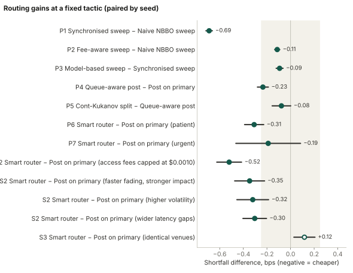

# Multi-venue smart order router

Can intelligent order routing materially improve execution once fees, rebates, queue position, latency, fill
probability, adverse selection and market impact are all counted? This repository builds a latency-aware
simulation of a fragmented equity market, eleven routing strategies from naive to optimised, and a
pre-registered set of experiments that answers the question for that market.

**Live demo:** [rasmuscodes.github.io/projects/smart-router](https://rasmuscodes.github.io/projects/smart-router/)
(write-up with the demo embedded) or [full screen](https://rasmuscodes.github.io/apps/smart-router/). It runs this
Python package in your browser (Pyodide, CPython compiled to WebAssembly); evaluation seeds 1-300 there reproduce
the experiments' numbers exactly. **Results:** [reports/RESULTS.md](reports/RESULTS.md). **Design frozen before the
runs:** [docs/PREREGISTRATION.md](docs/PREREGISTRATION.md).

## What it found

Paired comparisons over 300 evaluation seeds, Holm-corrected across nine pre-registered hypotheses, in a
simulated market (nothing here is a claim about live trading):

- **Marketable orders: routing pays, and the reason is latency.** A naive router that sends child orders to
  every venue at once finds 19% of the liquidity it saw gone on arrival: its first fill makes fast liquidity
  providers pull quotes on the slower venues. Synchronising arrivals cut that to 2% and saved **0.69 bps**
  [0.66, 0.72] on 99% of seeds. Fee awareness alone saved only 0.11 bps.
- **Resting orders: routing pays less, and rebates are a trap.** The full smart router beat naive posting on
  the primary venue by **0.31 bps** [0.23, 0.39] on a patient schedule; queue-aware venue choice alone saved
  0.23 bps. Chasing the highest maker rebate *cost* 0.06 bps: fills there carried the worst adverse selection,
  as Battalio, Corwin and Jennings (2016) find on US exchanges.
- **What did not pay:** optimising the split across venues (Cont and Kukanov, 2017) did not beat the best single
  venue, the smart router's edge on an urgent schedule was not significant, and learning venue quality from
  scratch within one order did not help.
- **Checks:** the gain held in four other market regimes (0.30-0.52 bps) and vanished with four identical venues.



Resting first instead of crossing the spread is worth about 3.7 bps, more than ten times what venue choice adds
for resting orders, but passive orders carry no permanent impact in this model, so that tactic gap is an upper
bound.

## What is inside

**The market** (`src/smartrouter/market.py`, [docs/MODEL.md](docs/MODEL.md)): a deterministic discrete-event
simulator with nanosecond time and price-time-priority books on four lit venues (maker-taker primary,
high-rebate, inverted, and a low-fee venue with an asymmetric speed bump and protection for resting orders) plus
a dark midpoint pool priced off a stale NBBO. A latent fair value moves with news jumps and taker impact.
Liquidity providers quote where their edge, net of fees, allows, and react to news and to trades on other
venues within microseconds; uninformed takers route fee-aware or by displayed size; latency arbitrageurs race
LPs for stale quotes. The router sees only delayed books and its own execution reports.

**The routers** (`src/smartrouter/router/`, [docs/ROUTERS.md](docs/ROUTERS.md)): one executor with a shared TWAP
schedule and interchangeable parts:

| Taking | Posting | Splitting |
|---|---|---|
| primary only, naive NBBO sweep, fee-aware sweep, synchronised sweep, model-based sweep (fill-probability sizing + dark ping) | primary, highest rebate, queue-aware (expected cost from fitted fill outcomes), Thompson sampling | Cont-Kukanov market/limit split by sample-average approximation; the combined smart router |

Model-based routers learn only from training seeds; evaluation seeds are never used for fitting.

**The experiments** (`src/smartrouter/experiments.py`): E1 taking, E2 posting, E3 splitting, E4 the end-to-end
headline on patient and urgent schedules, E5 four other regimes (fee cap $0.0010, faster fading, higher
volatility, wider latency gaps), E6 a negative control with identical venues. Every router runs on the same
seeds with common random numbers, so differences are measured seed by seed.

## Quick start

```
python -m venv .venv
.venv\Scripts\activate            # or: source .venv/bin/activate
pip install -e ".[dev]"
python -m pytest                  # 49 tests, about 20 s
python -m smartrouter run --strategy smart --seed 1          # one parent order, metrics as JSON
python -m smartrouter experiment E1 --seeds 40 --workers 4   # a quick version of one experiment
```

Reproduce everything (about 20 minutes on 6 cores): calibration for six regimes, all experiments, the report.

```
python -m smartrouter experiment all
python -m smartrouter report       # reports/RESULTS.md, reports/figures/, results/summary.json
python -m smartrouter validate     # stylised facts of the background market
python -m smartrouter bundle       # engine.zip + demo files for the website, into web/dist/
```

The simulator and routers use the standard library only; the analysis needs numpy, scipy and matplotlib.

## Reproducibility

- Runs are bit-identical across platforms: the simulation path uses IEEE-754 basic arithmetic only (no libm
  `log`/`exp`), random streams are platform-stable, and `tests/test_golden.py` locks four fingerprints.
- `results/` holds every episode's metrics (`*.jsonl.gz`), the fitted statistics per regime and run manifests;
  `python -m smartrouter report` rebuilds the report from them without re-simulating.
- Seeds: evaluation 1-300, development 500,000+, training 900,000+, validation 700,000+.

## Layout

| Path | What |
|---|---|
| `src/smartrouter/book.py`, `venue.py`, `market.py` | order books, venues, the event-driven market |
| `src/smartrouter/router/` | context (what a router sees), executor, policies, Cont-Kukanov, explorer, registry |
| `src/smartrouter/calibrate.py`, `experiments.py`, `analysis.py`, `report.py` | fitting, experiments, statistics, report |
| `src/smartrouter/demo.py`, `bundle.py`, `web/` | browser demo (Pyodide worker and page) |
| `docs/` | model, routers, validation, pre-registration |
| `reports/` | results and figures |
| `results/` | raw experiment outputs and fitted statistics |
| `tests/` | unit, differential, integration and golden tests |

## Limitations

One stylised stock and five stylised venues, mechanical liquidity providers that never learn about the router,
no permanent impact from passive orders, one TWAP schedule for every router. The venue parameters reproduce
qualitative facts from the empirical literature ([docs/VALIDATION.md](docs/VALIDATION.md)), not a particular
stock's data, so the magnitudes are specific to this market; the paired design makes the comparisons, not the
levels, the result.

## License

MIT.
