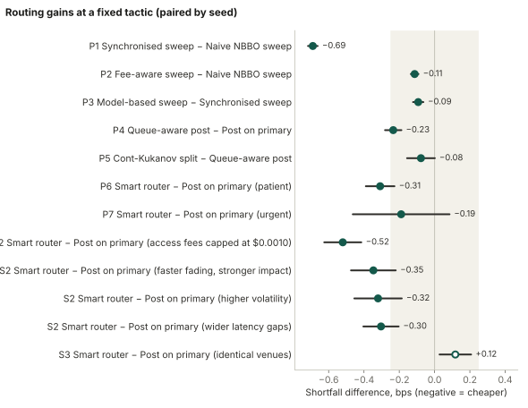
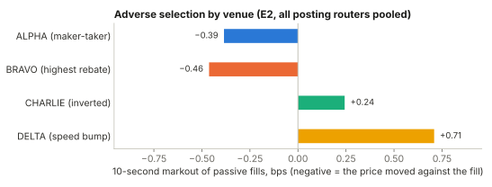
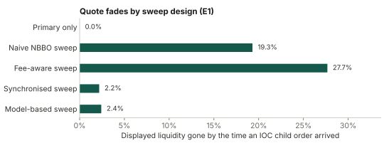
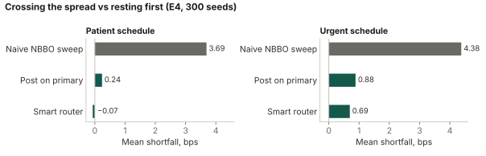

# Results

Built by `python -m smartrouter report` from the evaluation run of 2026-11-21 (outputs in `results/`). The hypotheses, metric, seeds and decision rules were fixed in [the pre-registration](../docs/PREREGISTRATION.md) before any evaluation seed was run. Everything here is about the simulated market described in [the model](../docs/MODEL.md); nothing is a claim about live trading.

## Short answer

- **Taking liquidity, routing pays and the reason is latency.** Sending child orders so that they arrive at every venue at once cut the share of displayed liquidity that vanished before arrival from 19% to 2% and saved 0.69 bps against the naive NBBO sweep [95% CI 0.66 to 0.72], cheaper on 99% of seeds. Fee awareness alone saved 0.11 bps (real but below the 0.25 bps bar): sent all at once, the cheaper venues are the slower ones, and their quotes fade first.
- **Resting liquidity, routing pays less, and rebates are a trap.** The full smart router beat naive posting on the primary venue by 0.31 bps on the patient schedule [0.23 to 0.39]. Queue-aware venue choice alone saved 0.23 bps, just under the bar. Chasing the highest maker rebate cost 0.06 bps: fills there carried the worst adverse selection.
- **What did not pay.** The Cont-Kukanov split across venues did not beat the best single venue (−0.08 bps, Holm p 0.1083), and on the urgent schedule the smart router's edge over naive posting (−0.19 bps) was not significant. Learning venue quality from scratch within one order (Thompson sampling) was no better than posting on the primary.
- **The biggest lever is not the venue.** Resting first instead of crossing the spread saved about 3.8 bps, 12 times what venue choice added for resting orders. In this model passive orders have no permanent price impact, so that number is an upper bound; the venue comparisons at a fixed tactic are the robust part.
- **Checks.** The smart router's gain over naive posting held in all four other regimes (−0.52, −0.35, −0.32, −0.30 bps), and vanished with four identical venues (+0.12 bps: no gain, a small cost of extra complexity).

So, in this market: **yes for marketable flow** (about 0.7 bps, 16% of the naive router's average cost, driven by latency rather than fees), **modestly for patient passive flow** (about 0.3 bps), and **no measurable gain** from optimising the split across venues or from routing urgent passive flow more cleverly.

Each row is a paired comparison over the same seeds, with its 95% interval; the shaded band marks ±0.25 bps, the pre-registered materiality bar. Hollow marker: the negative control, where no gain is expected.

## Primary hypotheses

Paired by seed (300 evaluation seeds), two-sided t-tests, Holm-Bonferroni across the nine. Negative = the first router is cheaper. Material = saving of at least 0.25 bps with Holm p < 0.05.

| | Comparison | Difference, bps | 95% CI | Bootstrap 95% | Cheaper on | Holm p | Verdict |
|---|---|---:|---|---|---:|---:|---|
| P1 | Synchronised fee-aware sweep vs naive NBBO sweep (taking) | −0.69 | −0.72 to −0.66 | −0.72 to −0.66 | 99% | < 0.0001 | Supported, material |
| P2 | Fee-aware sweep sent at once vs naive NBBO sweep (taking) | −0.11 | −0.13 to −0.09 | −0.13 to −0.09 | 76% | < 0.0001 | Supported, below the 0.25 bps bar |
| P3 | Model-based sweep vs synchronised sweep (taking) | −0.09 | −0.12 to −0.06 | −0.12 to −0.06 | 63% | < 0.0001 | Supported, below the 0.25 bps bar |
| P4 | Queue-aware post vs post on primary (posting) | −0.23 | −0.28 to −0.19 | −0.28 to −0.19 | 72% | < 0.0001 | Supported, below the 0.25 bps bar |
| P5 | Cont-Kukanov split vs queue-aware post | −0.08 | −0.16 to +0.00 | −0.15 to +0.00 | 53% | 0.1083 | Not supported |
| P6 | Smart router vs post on primary, patient schedule | −0.31 | −0.39 to −0.23 | −0.39 to −0.23 | 66% | < 0.0001 | Supported, material |
| P7 | Smart router vs post on primary, urgent schedule | −0.19 | −0.46 to +0.08 | −0.46 to +0.09 | 54% | 0.1751 | Not supported |
| P8 | Smart router vs naive NBBO sweep, patient schedule | −3.76 | −3.84 to −3.69 | −3.84 to −3.69 | 100% | < 0.0001 | Supported, material |
| P9 | Smart router vs naive NBBO sweep, urgent schedule | −3.68 | −3.95 to −3.42 | −3.94 to −3.42 | 94% | < 0.0001 | Supported, material |

Robustness of the tests: Holm-adjusted Wilcoxon signed-rank tests reach the same significance verdict as the t-tests for all nine hypotheses. The bootstrap intervals differ from the t intervals by at most 0.007 bps.

## Secondary hypotheses

**S1, the rebate trap.** Supported.

| Comparison | Difference | 95% CI | p |
|---|---:|---|---:|
| 10 s markout of passive fills: post for rebate − post on primary | −0.14 bps | −0.18 to −0.11 | < 0.0001 |
| 10 s markout of passive fills: post for rebate − queue-aware post | −0.50 bps | −0.55 to −0.45 | < 0.0001 |
| Shortfall: post for rebate − post on primary | +0.06 bps | +0.02 to +0.10 | 0.0046 |

Pooled over the posting routers of E2, passive fills on the inverted venue and the speed-bump venue were followed by favourable price moves, while fills on the two maker-taker venues were followed by adverse ones, worst on the highest-rebate venue. This is the pattern Battalio, Corwin and Jennings (2016) report for US exchanges: limit orders routed for rebates fill less and are picked off more.

**S2, robustness.** Supported in all eight tests (Holm within the group).

| Regime | Smart − post on primary | Smart − naive sweep | Holm p (both) |
|---|---|---|---|
| Access fees capped at $0.0010 | −0.52 [−0.62, −0.42] | −3.64 [−3.73, −3.56] | < 0.0001, < 0.0001 |
| Faster fading, stronger impact | −0.35 [−0.47, −0.22] | −5.54 [−5.65, −5.43] | < 0.0001, < 0.0001 |
| Higher volatility | −0.32 [−0.45, −0.19] | −3.79 [−3.91, −3.66] | < 0.0001, < 0.0001 |
| Wider latency gaps | −0.30 [−0.40, −0.20] | −3.79 [−3.88, −3.69] | < 0.0001, < 0.0001 |

**S3, negative control.** Supported. With four identical venues the synchronised and naive sweeps made identical decisions on every seed (difference exactly 0). The smart router was +0.12 bps against posting on the primary (90% interval +0.04 to +0.19: inside ±0.25 bps, so equivalent by the pre-registered test). It was slightly worse (p 0.0102): when there is nothing to route around, splitting across venues only costs.

**S4, learning.** Not supported.

| Comparison | Difference | 95% CI | p |
|---|---:|---|---:|
| Adaptive post − post on primary | −0.03 bps | −0.08 to +0.02 | 0.1927 |
| Adaptive post − queue-aware post | +0.20 bps | +0.15 to +0.26 | < 0.0001 |

A likely reason: twenty slices are too few decisions to learn which venue is toxic, while the same knowledge, fitted on training seeds, is what makes the queue-aware post work.

## The mechanisms

Fast liquidity providers watch every venue. When a large trade prints on one, they pull quotes on the others within tens of microseconds. A router that sends all child orders at once reaches the nearest venue first, and its own fill there triggers the fades that its slower child orders then run into. Ranking venues by fees makes this worse, because the venues with the best all-in prices are farther away. Staggering send times so that every child order arrives together removes most of it, which is the idea behind timed-release routers such as RBC's THOR.

## Tables

### E1 Taking liquidity: routing a marketable slice

With every slice crossing the spread at once (five 4,000-share slices, larger than any single venue's displayed queue), how much do fee awareness, synchronised arrival and a fill model save against the naive NBBO sweep?

| Router | Shortfall, bps (± se) | Price | Fees | Passive share | Faded | Dark share | Markout passive 10 s | Child orders |
|---|---:|---:|---:|---:|---:|---:|---:|---:|
| Primary only | 5.05 ± 0.54 | 4.45 | 0.60 | 0% | 0.0% | 0.0% | – | 9 |
| Naive NBBO sweep | 4.38 ± 0.55 | 3.80 | 0.58 | 0% | 19.3% | 0.0% | – | 22 |
| Fee-aware sweep | 4.27 ± 0.55 | 3.89 | 0.38 | 0% | 27.7% | 0.0% | – | 32 |
| Synchronised sweep | 3.69 ± 0.55 | 3.31 | 0.38 | 0% | 2.2% | 0.0% | – | 20 |
| Model-based sweep | 3.60 ± 0.54 | 3.22 | 0.38 | 0% | 2.4% | 3.0% | – | 24 |

### E2 Resting liquidity: where to post

Posting each 1,000-share slice at the NBBO for 11.25 s and crossing for the rest: does the venue choice matter once fill probability, adverse selection and clean-up cost are counted?

| Router | Shortfall, bps (± se) | Price | Fees | Passive share | Faded | Dark share | Markout passive 10 s | Child orders |
|---|---:|---:|---:|---:|---:|---:|---:|---:|
| Synchronised sweep | 3.27 ± 0.62 | 3.03 | 0.24 | 0% | 0.7% | 0.0% | – | 44 |
| Post on primary | 0.24 ± 0.64 | 0.59 | −0.35 | 92% | 0.3% | 0.0% | −0.36 | 36 |
| Post for rebate | 0.30 ± 0.64 | 0.81 | −0.51 | 88% | 0.3% | 0.0% | −0.50 | 39 |
| Queue-aware post | 0.00 ± 0.63 | 0.20 | −0.19 | 93% | 0.2% | 0.0% | 0.00 | 37 |
| Adaptive post (bandit) | 0.21 ± 0.63 | 0.30 | −0.09 | 93% | 0.3% | 0.0% | −0.08 | 37 |

### E3 Splitting a slice across venues

Does the Cont-Kukanov split between a market order and limit orders on several venues beat the best single-venue post and pure taking?

| Router | Shortfall, bps (± se) | Price | Fees | Passive share | Faded | Dark share | Markout passive 10 s | Child orders |
|---|---:|---:|---:|---:|---:|---:|---:|---:|
| Model-based sweep | 3.05 ± 0.62 | 2.83 | 0.23 | 0% | 0.6% | 9.5% | – | 61 |
| Queue-aware post | 0.00 ± 0.63 | 0.20 | −0.19 | 93% | 0.2% | 0.0% | 0.00 | 37 |
| Cont-Kukanov split | −0.07 ± 0.61 | 0.16 | −0.23 | 98% | 0.4% | 0.0% | −0.10 | 72 |
| Smart router | −0.07 ± 0.61 | 0.16 | −0.23 | 98% | 0.2% | 0.2% | −0.09 | 73 |

### E4 Headline: the smart router against naive routers: patient

End to end, does the full smart router beat a naive taking router and a naive posting router, for a patient and an urgent schedule?

| Router | Shortfall, bps (± se) | Price | Fees | Passive share | Faded | Dark share | Markout passive 10 s | Child orders | Permanent impact |
|---|---:|---:|---:|---:|---:|---:|---:|---:|---:|
| Naive NBBO sweep | 3.69 ± 0.62 | 3.10 | 0.59 | 0% | 4.2% | 0.0% | – | 34 | 4.02 |
| Post on primary | 0.24 ± 0.64 | 0.59 | −0.35 | 92% | 0.3% | 0.0% | −0.36 | 36 | 0.29 |
| Smart router | −0.07 ± 0.61 | 0.16 | −0.23 | 98% | 0.2% | 0.2% | −0.09 | 73 | 0.02 |

### E4 Headline: the smart router against naive routers: urgent

End to end, does the full smart router beat a naive taking router and a naive posting router, for a patient and an urgent schedule?

| Router | Shortfall, bps (± se) | Price | Fees | Passive share | Faded | Dark share | Markout passive 10 s | Child orders | Permanent impact |
|---|---:|---:|---:|---:|---:|---:|---:|---:|---:|
| Naive NBBO sweep | 4.38 ± 0.55 | 3.80 | 0.58 | 0% | 19.3% | 0.0% | – | 22 | 4.03 |
| Post on primary | 0.88 ± 0.57 | 1.15 | −0.26 | 82% | 1.4% | 0.0% | −0.76 | 13 | 0.72 |
| Smart router | 0.69 ± 0.48 | 0.94 | −0.24 | 85% | 0.8% | 1.1% | −0.66 | 33 | 0.54 |

### E5 Robustness across market regimes: fee_cap_10

Does the smart router's advantage survive lower fee caps, faster fading, higher volatility and wider latency gaps (each regime with its own calibration)?

| Router | Shortfall, bps (± se) | Price | Fees | Passive share | Faded | Dark share | Markout passive 10 s | Child orders |
|---|---:|---:|---:|---:|---:|---:|---:|---:|
| Naive NBBO sweep | 2.99 ± 0.74 | 2.79 | 0.19 | 0% | 4.7% | 0.0% | – | 36 |
| Post on primary | −0.14 ± 0.76 | −0.03 | −0.11 | 91% | 0.2% | 0.0% | −0.25 | 37 |
| Smart router | −0.66 ± 0.72 | −0.73 | 0.07 | 99% | 0.0% | 0.1% | 0.21 | 64 |

### E5 Robustness across market regimes: fast_fade

Does the smart router's advantage survive lower fee caps, faster fading, higher volatility and wider latency gaps (each regime with its own calibration)?

| Router | Shortfall, bps (± se) | Price | Fees | Passive share | Faded | Dark share | Markout passive 10 s | Child orders |
|---|---:|---:|---:|---:|---:|---:|---:|---:|
| Naive NBBO sweep | 5.22 ± 0.78 | 4.63 | 0.59 | 0% | 5.2% | 0.0% | – | 35 |
| Post on primary | 0.02 ± 0.80 | 0.38 | −0.36 | 93% | 0.9% | 0.0% | −0.47 | 37 |
| Smart router | −0.33 ± 0.76 | −0.11 | −0.22 | 98% | 0.9% | 0.1% | −0.28 | 76 |

### E5 Robustness across market regimes: high_vol

Does the smart router's advantage survive lower fee caps, faster fading, higher volatility and wider latency gaps (each regime with its own calibration)?

| Router | Shortfall, bps (± se) | Price | Fees | Passive share | Faded | Dark share | Markout passive 10 s | Child orders |
|---|---:|---:|---:|---:|---:|---:|---:|---:|
| Naive NBBO sweep | 4.34 ± 1.05 | 3.76 | 0.58 | 0% | 5.5% | 0.0% | – | 38 |
| Post on primary | 0.87 ± 1.06 | 1.26 | −0.39 | 98% | 0.0% | 0.0% | −0.61 | 36 |
| Smart router | 0.55 ± 1.02 | 0.77 | −0.22 | 98% | 0.5% | 0.2% | −0.16 | 84 |

### E5 Robustness across market regimes: wide_latency

Does the smart router's advantage survive lower fee caps, faster fading, higher volatility and wider latency gaps (each regime with its own calibration)?

| Router | Shortfall, bps (± se) | Price | Fees | Passive share | Faded | Dark share | Markout passive 10 s | Child orders |
|---|---:|---:|---:|---:|---:|---:|---:|---:|
| Naive NBBO sweep | 3.18 ± 0.74 | 2.59 | 0.59 | 0% | 4.2% | 0.0% | – | 34 |
| Post on primary | −0.30 ± 0.76 | 0.05 | −0.35 | 92% | 0.4% | 0.0% | −0.38 | 36 |
| Smart router | −0.61 ± 0.73 | −0.38 | −0.23 | 98% | 0.2% | 0.2% | −0.12 | 72 |

### E6 Negative control: identical venues

With four identical venues and no dark pool, there is little to route around. Do the smart router's gains shrink towards zero, as they should?

| Router | Shortfall, bps (± se) | Price | Fees | Passive share | Faded | Dark share | Markout passive 10 s | Child orders |
|---|---:|---:|---:|---:|---:|---:|---:|---:|
| Naive NBBO sweep | 3.25 ± 0.74 | 2.65 | 0.60 | 0% | 0.3% | 0.0% | – | 39 |
| Synchronised sweep | 3.25 ± 0.74 | 2.65 | 0.60 | 0% | 0.3% | 0.0% | – | 39 |
| Post on primary | −0.82 ± 0.75 | −0.45 | −0.38 | 98% | 0.1% | 0.0% | 0.08 | 32 |
| Queue-aware post | −0.78 ± 0.75 | −0.41 | −0.37 | 97% | 0.0% | 0.0% | 0.07 | 32 |
| Smart router | −0.71 ± 0.72 | −0.32 | −0.39 | 99% | 0.1% | 0.0% | −0.07 | 60 |

Shortfall levels include the market's random drift over each order (standard deviation about 10 bps), so compare routers through the paired differences above, not through these means. Permanent impact is fair value at the end of the horizon with the order minus without it, from a counterfactual run of the same seed.

## Deviations from the pre-registration

None in the simulator, the routers or the analysis. The first launch of the evaluation run stopped before simulating anything (the package was not installed in the environment) and was restarted unchanged. After the evaluation, only documentation, packaging metadata, the report generator and the browser demo were added.

## Limitations

- One simulated stock, five stylised venues, mechanical liquidity providers that never learn about the router. The parameters follow qualitative facts from the literature (see [validation](../docs/VALIDATION.md)) rather than a calibration to a particular stock and day.
- Passive orders have no permanent impact here, so the tactic gap (resting vs crossing) is an upper bound.
- Every router uses the same TWAP schedule; scheduling itself is not optimised.
- The calibration probes rest one order at a time; the venue model ignores how much its own order changes takers' routing.
